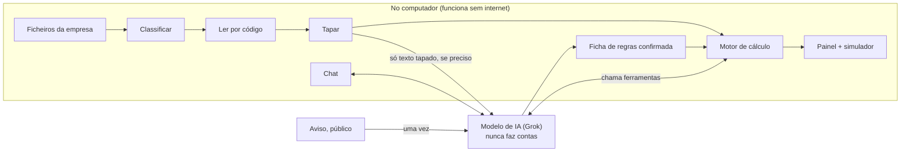

# Dossier do hackathon · Monitorização de metas

> Versão de 23 out 2026. Só o que serve durante o evento. Os números das empresas estão em `empresa-inventada.md` e nas folhas de respostas.

## O essencial em um minuto

SpaceXAI Digital Transformation Lab: **26 e 27 de outubro, Fórum Braga, tudo em inglês**. Equipa: o António (constrói com o Cursor) e a colega da BF (dona do problema). Cerca de **9 horas de construção**, **5 minutos** de pitch e 3 de perguntas.

Constrói-se de raiz um monitor de metas de projetos com incentivos:

1. Larga-se o aviso e os documentos da empresa, em qualquer formato.
2. Um clique: aparece o painel completo, com o estado de cada meta em %, o corte previsto em € e a sugestão mais barata para o evitar.
3. Por baixo, um chat que transforma o próprio painel num simulador ("e se contratar 1 pessoa a 1.500 €?").

O júri tem de sair a pensar três coisas: **os dados dos clientes estão protegidos**, **os números estão certos** e **isto poupa dinheiro a sério**. O que não serve uma destas três fica de fora.

## Regras do evento que mudam o plano

| Regra | O que muda para nós |
|---|---|
| Construção de raiz; trabalho prévio dá desqualificação (`regras-taikai.txt`, secções 7 e 8) | Nada de código de casa. Leva-se conhecimento: regras de cálculo, instruções para os agentes, dados inventados |
| Ferramenta: Cursor (aula às 11:00 do dia 1) | Instruções de trabalho já escritas (`AGENTS.md`, `.cursor/`) |
| Entrega na TAIKAI até **27 out, 13:00** | Publicada ao almoço do dia 2 |
| Tudo em inglês | Pitch, ecrãs e textos da TAIKAI em inglês |
| Pitch 5 min + 3 min de perguntas | Frases-chave treinadas; respostas difíceis preparadas |
| Entregáveis: descrição, papel da IA, capturas ou demo, tecnologias, arquitetura (sistemas de origem e domínios de dados) | Agente de apresentação e colega, dia 2 de manhã |
| Link do código opcional e público | Só uma cópia limpa, sem `contexto/` |
| Propriedade intelectual da BF | O módulo passa para o portal depois |

**Critérios do júri:** inovação 30%, implementação técnica 30%, impacto 20%, apresentação 20%. **Categoria:** Data Handling.

## Problema

A BF acompanha mais de 100 projetos com metas contratuais. Hoje verificam-se uma vez por ano, quando sai a IES, à mão em Excel: 25 a 30 horas por projeto. Caso real: o desvio na meta de emprego só se viu no fecho da IES e custou um corte superior a 30.000 €.

**A conta que impressiona:** 100 projetos × 25 a 30 h = **2.500 a 3.000 horas por ano** (confirmar com a colega que é por ano).

## Solução

### O que o utilizador vê

| Ecrã | O que acontece |
|---|---|
| **1. Entrada** | Uma zona para largar tudo: o aviso e os documentos da empresa (PDF, Excel, CSV, Word). Cada ficheiro é classificado sozinho; os irrelevantes ficam de lado com a razão; o que falta aparece pedido ("Missing: Q3 trial balance") |
| **2. Painel** | Em destaque, o **RO projetado em %** e o estado ("Cut expected: 1.5 p.p. = €37,500"). Por baixo, cada indicador contratado com a **% da meta**, o estado, o prazo para agir e o botão "Verify" (conta + documento de origem). A seguir, a sugestão: o caminho mais barato para não haver corte |
| **3. Chat, por baixo** | Perguntas e simulações. Ao simular, o **próprio painel entra em modo simulação**: cada indicador mostra antes → depois. Também há controlos diretos no painel para quem não quer escrever |

Botão "Add document": entra o documento do trimestre seguinte, o painel atualiza-se e mostra o que mudou.

Design: elegante, limpo, com transições, efeitos de hover e movimento com sentido (o painel revela-se por partes; os números contam até ao valor; em simulação, os indicadores deslizam para o novo valor).

### Como funciona (árbitro e comentador)

O aviso é o regulamento, os documentos são o marcador, o código é o árbitro e a IA é o comentador. A IA lê e explica; quem conta é o código.

1. **Aviso → ficha de regras.** A IA lê só a secção dos indicadores e das penalizações (encontrada pelos títulos) e preenche uma ficha: indicadores, limiar, escalões, "2 melhores" ou pesos. As fórmulas vêm de um catálogo fixo; a IA só escolhe. Um consultor confirma uma vez e a ficha serve todos os projetos desse aviso. O aviso é público: não precisa de ser tapado.
2. **Documentos → números.** Formatos estruturados (Excel, CSV, PDF com texto de programa de contabilidade) lidos por código, sem internet. Formatos desconhecidos e documentos desarrumados (certificados, termo de aceitação) lidos pela IA **já tapados**; o código confere (balancete: débito = crédito; totais por classe). Se não bater, pede revisão.
3. **Tapar.** NIF, NISS, IBAN, emails, telefones, moradas, nomes de pessoas e de empresas → etiquetas estáveis (`[NIF_FORNECEDOR_1]`). Valores e datas ficam. Ecrã "Before / After" e registo de tudo o que foi à IA. Pseudonimização, nunca "anonymised".
4. **Motor.** Indicadores, projeção para o ano de cruzeiro, RO, corte em €, prazo para agir e sugestão. Código puro com testes. **O painel funciona sem internet e sem IA.**
5. **Chat.** A IA percebe a pergunta, chama as ferramentas do motor (ler indicadores, simular) e explica, citando a fonte. Nunca faz contas.

### Os dois momentos que ficam na cabeça

- **O prazo para agir.** O ETI anual é uma média do ano: quem contrata em novembro só conta 2/12 de uma pessoa. O painel diz "1 graduate would have been enough by September. Today: 2, starting 1 November." É o caso real dos 30.000 €, resolvido.
- **Contratar mexe em três indicadores.** Um licenciado sobe o emprego e o emprego qualificado, mas baixa o VA por trabalhador. Como só entram os 2 melhores, o simulador mostra que perfil compensa. Conselho de consultor, calculado.

## Âmbito

Fases, critério de "pronta" e o que fica de fora: `KICKOFF.md`. A ordem é entrada → painel → simulador e chat → pormenores: sem dados certos não há painel, e o painel é o que o júri vê primeiro. No pitch, próximo passo: o **SAF-T** (ficheiro de contabilidade que todos os programas exportam) como forma de chegar a zero trabalho.

**Destino depois do evento:** no portal de cliente da BF, do lado do consultor, o projeto já tem o aviso e os documentos. Um botão "Ver metas" abre o painel num modal. Zero ficheiros para largar. A demo tem de mostrar que este destino é credível: as perguntas da demo (folha de respostas, secção 5) escolhem-se para provar valor e robustez.

## Como se ganha

A maioria das equipas leva "um chat que lê os PDFs da empresa". Os guias da TAIKAI: chatbots colados a um produto já não ganham; ganha quem trata uma restrição dura como funcionalidade e torna a precisão verificável num clique.

| Critério | Peso | Trunfo | Como se prova na demo |
|---|---|---|---|
| Inovação | 30% | Painel que é simulador; qualquer aviso vira regras; dados tapados antes da IA | Largar outro aviso e o painel mudar; "Before / After" |
| Implementação técnica | 30% | Motor sem IA, testado; IA só onde é precisa; funciona sem internet | Desligar o Wi-Fi e o painel continuar; botão "Verify"; "X/Y values match" |
| Impacto | 20% | 100+ projetos, 2.500–3.000 h/ano, caso dos 30.000 € | Abrir com o caso; fechar com "any consultancy or accountant" |
| Apresentação | 20% | Simulação ao vivo | Contratar 1 licenciado e ver o RO passar de vermelho a verde |

**A história do Cursor:** quem constrói não é programador e orquestra agentes e subagentes com instruções escritas. Uma frase, com horas. O Cursor é o protagonista.

**O que nos faz perder:** a demo falhar ao vivo. Defesas: painel sem internet, âmbito por fases, fim de funcionalidades às 11:00 do dia 2, vídeo de plano B, respostas guardadas.

## Guião da demo (5 minutos)

O guião final escreve-se no evento, a partir do que existir. Esta é a estrutura.

| Tempo | Quem | O que se mostra | Frase-chave |
|---|---|---|---|
| 0:00–0:40 | Colega | O caso real | "We found out a year too late. It cost our client over 30,000 euros." |
| 0:40–1:20 | António | Largar aviso e documentos; "Before / After" | "The AI never sees a tax ID, a name or a bank account." |
| 1:20–2:10 | António | Painel: RO, % por indicador, corte em €, prazo | "Three quarters before the annual accounts, we already know." |
| 2:10–3:20 | António | "What if we hire one graduate at 1,500?" → painel em simulação | "The AI understands the question. The numbers come from code." |
| 3:20–4:00 | António | Wi-Fi desligado, painel continua; "Verify"; esquema | "Every number matches our consultant's own calculation." |
| 4:00–5:00 | Colega | Impacto e próximos passos | "Built in two days, by a non-developer, with Cursor." |

Ensaia-se duas vezes com cronómetro, dia 2, 13:00–14:00.

## Perguntas difíceis do júri

| Pergunta | Resposta |
|---|---|
| Isto não é só um chat com PDFs? | O painel nem usa IA: as contas são código testado e funcionam sem internet. A IA lê o que é desarrumado e explica. |
| Funciona com qualquer aviso? | Sim, dentro dos indicadores do catálogo. A IA lê o aviso, um consultor confirma uma vez, e serve todos os projetos desse aviso. |
| E se a IA ler mal o aviso? | Por isso há confirmação humana e um catálogo fixo de fórmulas: a IA escolhe, não inventa. Testámos contra avisos lidos à mão. |
| E se o tapar falhar um nome? | Padrões (NIF, NISS, IBAN, emails) mais a lista de nomes do próprio documento. Registo do que foi enviado e revisão. |
| Está anonimizado? | Pseudonimizado: a chave existe mas nunca sai do computador. A IA só vê etiquetas. |
| Os valores não identificam a empresa? | Em teoria podem. A IA recebe o mínimo; passo seguinte: rácios em vez de valores. |
| Porque não um modelo local? | Os modelos de portátil ainda são mais fracos. Tapar permite usar o melhor modelo; a arquitetura deixa trocar. |
| Um simulador de contratação é IA de alto risco (AI Act)? | Não escolhe nem avalia pessoas: calcula custo contra incentivo em risco. A decisão é da empresa, com o consultor. |
| Dados trimestrais chegam? | Dão três avisos antes da IES, quando ainda há tempo de agir. |
| Quem paga e como escala? | Entra no portal da BF na assistência técnica. O problema existe em qualquer consultora e contabilista. |
| Papel da IA na construção? | Dois agentes no Cursor, mais subagentes verificadores. Nós decidimos o problema e as regras e verificámos cada número. |

## Equipa

| Quem | No evento | No pitch |
|---|---|---|
| António + construtor (Cursor) | Constrói por fases; acompanha a verificação | Mostra a demo (0:40–4:00) |
| Colega | Confere números com a folha de respostas; testa o chat com perguntas reais; revê slides; TAIKAI | Abre com o caso, fecha com o impacto |
| Agente de apresentação (Cursor, chat próprio) | Guião, slides, perguntas, descrição, arquitetura em `pitch/` | Não aparece |

Perguntas de negócio e incentivos: colega. Como funciona: António.

## Plano das horas

| Quando | Construtor | Colega | Tem de estar feito |
|---|---|---|---|
| Dia 1, 11:30–12:00 | Mentores; colar o `KICKOFF.md` em Plan Mode | Igual | Problema confirmado |
| Dia 1, 12:00–13:00 | Responder às perguntas do plano; aprovar; esqueleto da app | Projeto na TAIKAI | Plano aprovado; app abre |
| Dia 1, 14:00–16:00 | **Fase 1** | Conferir leitura com a folha | Documentos lidos e tapados |
| Dia 1, 16:00–18:00 | **Fase 2** | Conferir indicadores e RO | Painel certo |
| Dia 2, 09:15–11:00 | **Fase 3** (e 4, se houver folga) | Testar as 3 perguntas; descrição TAIKAI | Simulador e chat |
| **Dia 2, 11:00** | **Fim de funcionalidades novas** | | Só correções |
| Dia 2, 11:00–12:00 | Vídeo de plano B; capturas | Slides; arquitetura | Vídeo gravado |
| Dia 2, 12:00–13:00 | Publicar na TAIKAI | Rever | **Entregue antes das 13:00** |
| Dia 2, 13:00–14:00 | Ensaiar 2× | Igual | Pitch < 5 min |

## Riscos e planos B

| Risco | Plano B |
|---|---|
| Demo falha ao vivo | Painel sem internet; vídeo de plano B; respostas guardadas |
| Internet ou IA lenta | Painel e simulador continuam; chat usa respostas guardadas; hotspot |
| Valores não batem | Mostrar menos indicadores, mas certos |
| IA lê mal o aviso | Ficha confirmada à mão no ecrã de confirmação |
| Formato de ficheiro inesperado | Leitura pela IA com conferência; se falhar, pedir outro formato |
| Tapar deixa passar um nome | Lista de nomes do documento; auditor de privacidade |
| Acaba o tempo | Cortar pela ordem inversa: fase 4, depois chat livre. O modo simulação fica |
| Júri suspeita de trabalho prévio | A organização confirmou por escrito que se pode levar o que temos. Primeiro commit só com .md e dados inventados; dizemo-lo na descrição |
| Dados reais na demo | Proibido, incluindo capturas e vídeo |
