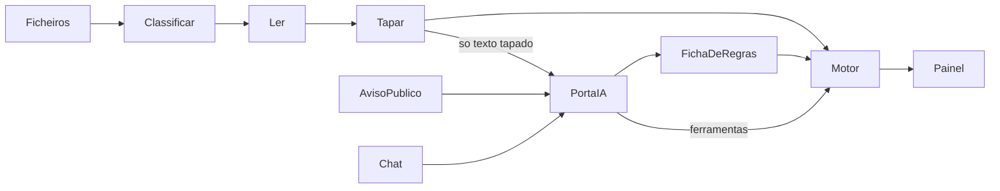

# Monitor de metas

Li o dossier, as regras, as duas empresas, as duas folhas e os 46 ficheiros de `dados-demo/` (3 avisos, 17 da A, 24 da B, 2 de "Add document"). Não há código. As regras com selo [INTERPRETAÇÃO] e [ESTIMATIVA] entram como estão: sem teto de 100% por rácio, escalão incompleto conta, VA pelas contas do aviso, 14 salários, TSU 23,75%, seguro 1,5% editável, qualificado = nível 6 ou mais, diploma estrangeiro não conta até o consultor confirmar. O GC fica de fora. Um projeto de cada vez.

## 1. Propostas para dizeres sim ou corrigires

1. Obrigatórios para o painel da A: aviso, termo, os 3 balancetes e o mapa de pessoal. Sem o balancete de setembro, o painel pede o T3. Sem a fatura ou a apresentação, não pede nada. Sem o RU, a IES de 2023 ou a DR de setembro, calcula na mesma e diz que não cruzou. Proposta: sim.
2. Na fase 2 as metas, o pré-projeto, os 2.500.000 € e os 45% vêm de uma leitura já conferida do termo, e só se o PDF do termo foi largado. A IA passa a ler o termo na fase 4c e tem de chegar aos mesmos números. Proposta: sim.
3. As fichas do MPR-2024-3 e do MPr-2023-1 ficam gravadas, iguais à secção 11 de [contexto/regras-calculo.md](contexto/regras-calculo.md), para o painel viver sem rede. O MPR-2026-6 não fica gravado: é o aviso novo, lido pela IA, com confirmação. Se a IA falhar, o consultor preenche a ficha a partir do catálogo. Proposta: sim.
4. Na sugestão, o salário por defeito é 1.500 € para qualificado e 1.000 € para não qualificado. Dá para editar. No Verify fica marcado como estimativa. Proposta: sim.
5. A sugestão mostra as duas saídas da folha, por esta ordem: 2 licenciados a 1 de novembro (8.767,50 €, evitam 37.500 €) e, em alternativa, vender mais 67.000 € até 31 de dezembro. Proposta: sim.
6. No painel da demo o RO vai a 56px, para se ler no projetor. O resto da app fica em 16, 18 e 24. É a exceção ao teto de 36px dos ecrãs normais. Proposta: sim.
7. Não há `DESIGN.md` nem o ficheiro da letra da BF. Uso IBM Plex Sans (uma família, algarismos da mesma largura, acentos). Se puseres o ficheiro da letra, troca-se num sítio só. Proposta: sim.

## 2. Arquitetura

O código é o árbitro. A IA é o comentador.

- `ingest/` classifica por regras. A IA só entra se o tipo for desconhecido, e já com o texto tapado.
- Os leitores conhecidos (balancete, mapa, RU, IES, DR) extraem linhas com origem. Quem soma é o motor: contas de razão se existirem, senão o último nível, nunca os dois. Débito tem de igualar crédito.
- `ingest/pseudonymise.ts` troca NIF, NISS, IBAN, email, telefone, morada e nomes por etiquetas estáveis. O dicionário fica em memória e não se grava.
- `ai/gateway.ts` é a única função que fala com o Grok (`XAI_API_KEY`, `XAI_MODEL` em `.env.local`). Tapa, regista o texto tapado e a resposta, e não envia se a prova de fuga falhar. O aviso passa pela mesma porta, marcado como público.
- `domain/` calcula indicadores, ETI, projeção, RO, corte, prazo e sugestão. Funções puras, sem React e sem rede. A ficha de regras é dados: limiar, escalões, `best_n`.
- O painel só desenha o resultado. "Verify" abre a conta e o documento. O chat chama `read_indicators` e `simulate`. Cada número da frase tem de existir no resultado do motor.
- Um projeto de cada vez, em memória no portátil. O registo tapado vai para `data/ai-log/`, fora do git.
- "Hoje" é a constante 27 out 2026. A projeção usa os meses do último balancete (na A, 9), não o relógio do PC.
- Formatos e respostas da IA passam por Zod. Os testes em `tests/expected/` copiam a folha e não leem `contexto/`.



## 3. Pastas e contrato

```
app/                 uma página, estados: largar, rever, confirmar ficha, painel
components/          desenha, não calcula
domain/              types, schemas, eti, accounts, indicators, ro, cut, suggest, simulate
ingest/              classify, pdf-text, readers, pseudonymise, names
ai/                  gateway, extract-call, tools, cache, log
tests/expected/      valores copiados das folhas, com a secção de origem
data/ai-log/         gitignored, só texto tapado
```

Não mexo em `pitch/` nem em `contexto/`. O `DESIGN.md` nasce na fase 0 com a direção aprovada.

Tipos centrais, validados com Zod em cada fronteira:

- **Ficheiro classificado:** nome, tipo (`call`, `acceptance_term`, `trial_balance`, `staff_map`, `single_report`, `ies`, `social_security_dr`, `certificate`, `irrelevant`, `unknown`), período, razão, e se foi regra ou modelo.
- **Dados normalizados:** linhas de balancete (conta, nível, débito, crédito, saldo, origem), pessoas (entrada, saída, horas semanais, nível QNQ, origem), conferências da IES e das DR. Cada número traz documento e sítio (página, folha ou célula).
- **Ficha de regras:** código do aviso, indicadores do catálogo, modelo `best_n` ou `weighted`, n, pesos, limiar, passo da penalização, máximo de p.p., ano pré-projeto. Fora do catálogo: `not supported`.
- **Resultado do motor:** por indicador, projeção, pré-projeto, Ie, I, percentagem da meta e estado (`on_track` ≥ 100%, `at_risk` 70–100%, `off_track` < 70%); os 2 melhores; RO; p.p.; corte em €; prazo; sugestão; rasto para o Verify.

## 4. Fases

Cada fase fecha com os subagentes que se aplicarem (`revisor-tecnico`, `verificador`, `auditor-privacidade`), o bloco Explicação, uma entrada no [EXPLICACAO.md](EXPLICACAO.md) e um commit em inglês por peça verificada. Se apertar, corta-se a fase 4 e depois o chat livre. O modo simulação fica.

**0. Esqueleto.** Eu sozinho: Next.js, TypeScript estrito, ESLint, Prettier, Vitest, Tailwind, shadcn, tokens, `DESIGN.md`, página com o painel em números da folha da A marcados como amostra. Confirmo as APIs em `node_modules/next/dist/docs/` antes de as usar. Pronta quando abre no browser do Cursor e `lint`, `typecheck` e `test` passam.

**1. Entrada.** Primeiro fecho os tipos. Depois, em paralelo e em ficheiros diferentes: um subagente nos três balancetes da A, outro no mapa, RU, IES e DR da A, outro no tapar e no teste que falha se um NIF, NISS ou IBAN chegar ao texto da IA. Eu fico com o classificador, a zona de largar, a lista do que falta e o ecrã Before / After. A B só é classificada. Pronta quando a secção 1 da A bate, o classificador acerta nos 46 ficheiros, o auditor não vê fugas, e tirar o balancete de setembro faz o painel pedir o T3.

**2. Painel.** Um subagente no motor e nos testes das secções 2 e 3 (inclui a evolução T1 58,99%, T2 73,39%, T3 64,50% e o corte de 37.500 €). Eu fico com o painel, o Verify e o ecrã de confirmar a ficha. Outro subagente, só em `ai/`, lê o aviso pela porta única. Pronta quando o verificador bater as secções 2 e 3, a ficha bater a tabela dos avisos, e o painel continuar com o Wi-Fi desligado.

**3. Simulador e chat.** O motor de simular já existe da fase 2. Eu faço os controlos e o deslize do antes para o depois. Um subagente escreve as 3 respostas guardadas da A e o teste que exige fonte e números iguais à secção 5. A IA explica; se demorar ou estiver offline, entra a resposta guardada sem roda a girar. As 3 da B ficam para a 4b. Pronta quando a secção 4 bater e as 3 perguntas da A responderem com fonte.

**4. Pormenores, por esta ordem, só com as anteriores verificadas.** a) Certificados e emprego qualificado. b) Empresa B: limiar 85%, emprego pelo RU e pelas DR, grau da Juliana por confirmar. c) A IA lê o termo. d) Add document, com o que mudou. e) Polimento das transições. Cada alínea verifica-se como as fases de cima. A 4b usa a folha B (70/70 no simulador da BF).

## 5. Direção visual

Recomendação: **folha de trabalho**. Fundo papel quente (`#f4f3ef`), tinta `#1c1b19`, cor só na ação e nos estados. Verde escuro para "no cut" e "on track", âmbar para "at risk", vermelho só no valor do corte. Sem gradiente, sem cartões de KPI, sem ícone em círculo.

A alternativa é um formulário branco com ação azul, mais frio e mais fácil de ignorar numa sala. O ecrã quase preto com número néon fica de fora: lê-se mal no projetor.

- IBM Plex Sans. RO a 56px. A percentagem de cada meta a 24px. Algarismos tabulares. Dinheiro como na demo: €37,500.00.
- Os quatro indicadores são uma lista com filetes de 1px: percentagem, estado em palavras, barra, Verify. A barra cresce com `scaleX`, não com largura.
- Abertura em cascata curta, números que contam até ao valor, simulação que desliza o antes para o depois com a diferença a verde ou vermelho. `prefers-reduced-motion` tira o deslocamento e deixa o valor final. Sem biblioteca de animação.
- Um gesto só: um traço inclinado, no espírito das barras da BF, ao lado do RO.

Protótipo do painel, o único ecrã a construir primeiro:

```
Demo Têxtil                         MPR-2024-3 · cruise year 2026 · to 30 Sep

Projected result of the operation          Cut expected
64.50%                                     1.5 p.p. = €37,500
Threshold 70%                              1 hire would have been enough by 1 Sep.
                                           Today: 2, starting 1 Nov.

Turnover                         104.00%   On track
Value added per worker            25.00%   Off track
Jobs created                      22.22%   Off track
Qualified jobs created            20.83%   Off track
                                           Verify on each row

Suggestion · to be confirmed by your BF consultant
2 graduates from 1 Nov: €8,767.50 until 31 Dec, avoids €37,500.
Or sell €67,000 more by 31 Dec, no direct cost.

Hires  2    Graduate    €1,500    from 1 Nov          Extra sales  €
```

O chat fica por baixo, fora deste primeiro ecrã. Antes disto, a mesma página passa por largar ficheiros, Before / After e confirmar a ficha. Painel lateral para o Verify. Modal só para uma ação grave, e nesta demo não há nenhuma.

## 6. Explicação

**O que fiz:** Fechei a arquitetura do monitor, ainda sem código: o portátil faz as contas e a IA só lê o que está tapado e explica o resultado.
**Como funciona:** É um árbitro e um comentador de jogo. O árbitro marca o resultado com as regras. O comentador diz o que se passou.
**Porquê assim:** A alternativa era um chat a ler os PDFs e a fazer as contas. Essa falha com o Wi-Fi desligado e o júri não consegue repetir o número.
**Verifiquei:** Li os seis documentos pedidos e os 46 ficheiros da demo. App ainda não existe: 0 testes corridos.
**Para o júri (EN):** "The code is the referee and the AI is the commentator. Every number on the panel comes from tested code, and it still works with the Wi-Fi off."
